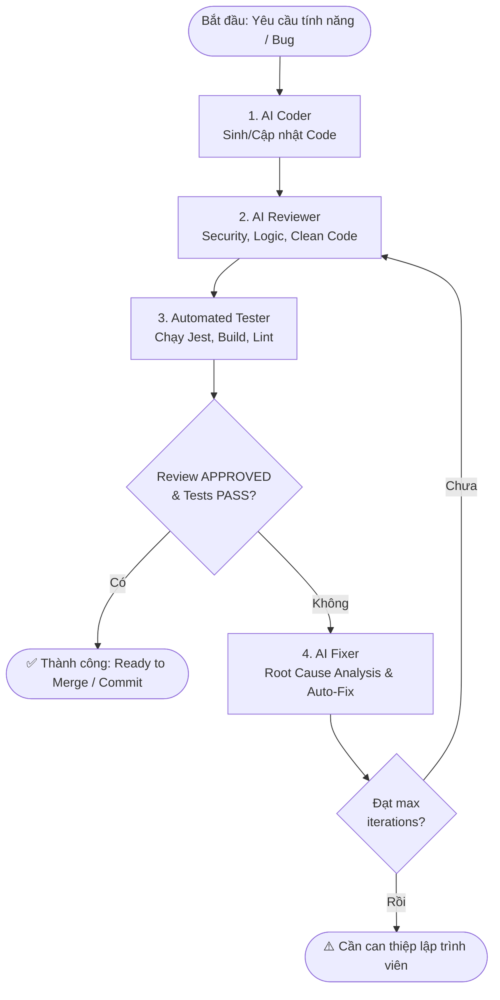

# 🚀 Autonomous AI Dev Pipeline: Code -> Review -> Fix -> Test

Pipeline kỹ nghệ phần mềm tự động hóa với vòng lặp phản hồi tự sửa lỗi (**Self-Healing Feedback Loop**) khép kín gồm 4 giai đoạn:
1. **AI Coder**: Sinh mã nguồn hoặc cập nhật tính năng theo yêu cầu.
2. **AI Reviewer**: Đánh giá logic, code smell, lỗ hổng bảo mật (OWASP), hiệu năng và chuẩn clean code.
3. **Automated Tester**: Chạy kiểm thử tự động (`npm test`, lint, build) và kiểm tra lỗi thời gian chạy.
4. **AI Fixer**: Khi phát hiện lỗi hoặc blocker, tự động phân tích nguyên nhân gốc (RCA), tạo bản vá và re-loop cho đến khi đạt chuẩn.

---

## 🏗️ Kiến Trúc Hoạt Động (Architecture Flow)



---

## ⚡ Cài Đặt & Sử Dụng (Quick Start)

Pipeline được viết bằng **Pure Node.js (Node 18+)**, **không yêu cầu cài thêm thư viện ngoài (zero-dependencies)**.

### 1. Cấu hình Khóa API (Optional)
Hỗ trợ Google Gemini API (mặc định) hoặc OpenAI / OpenRouter / Ollama:
```bash
# Windows PowerShell:
$env:GEMINI_API_KEY="AIzaSy..."

# Hoặc OpenAI:
$env:OPENAI_API_KEY="sk-..."
```
*(Nếu không cung cấp API Key, pipeline sẽ tự động chạy ở chế độ **Mock Simulation** để demo luồng).*

---

### 2. Các Lệnh Thực Thi Phổ Biến

#### A. Chạy toàn bộ Pipeline với một yêu cầu mới:
```bash
node ai-pipeline/pipeline.js --task "Thêm nút chuyển đổi lớp bản đồ vệ tinh sang OpenStreetMap"
```

#### B. Chạy chế độ Thử nghiệm (Dry-Run & Mock):
```bash
node ai-pipeline/pipeline.js --mock --task "Tạo MapControls zoom reset" --dry-run
```

#### C. Chỉ chạy Review trên các thay đổi git hiện tại:
```bash
node ai-pipeline/pipeline.js --stage review
```

#### D. Chỉ chạy Test & Báo cáo:
```bash
node ai-pipeline/pipeline.js --stage test
```

---

## ⚙️ Tùy Biến Cấu Hình (`config.json`)

File `simplemap/ai-pipeline/config.json`:
```json
{
  "provider": "gemini",
  "geminiModel": "gemini-2.5-flash",
  "openaiModel": "gpt-4o-mini",
  "maxIterations": 3,
  "testCommand": "npm test -- --watchAll=false",
  "buildCommand": "npm run build",
  "sourceDir": "src",
  "strictReview": false,
  "autoApplyFix": true
}
```

- `maxIterations`: Số vòng lặp tự sửa lỗi tối đa (mặc định: `3`).
- `strictReview`: Nếu `true`, bất kỳ `WARNING` nào cũng yêu cầu sửa đổi; nếu `false`, chỉ chặn khi có `BLOCKER` hoặc điểm review < 7.
- `autoApplyFix`: Tự động áp dụng file sửa lỗi vào thư mục mã nguồn.

---

## 🤖 Tích Hợp Antigravity / IDE Custom Agents

Bạn có thể tận dụng các prompt mẫu trong `ai-pipeline/prompts/`:
- `coder.prompt.md`: System prompt cho AI Coder
- `reviewer.prompt.md`: Tiêu chuẩn review bảo mật & chất lượng
- `fixer.prompt.md`: Cơ chế phân tích nguyên nhân gốc (RCA)
- `tester.prompt.md`: Sinh kịch bản kiểm thử Jest / React Testing Library

